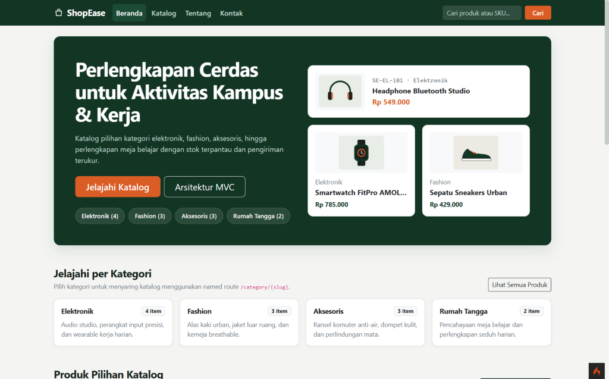
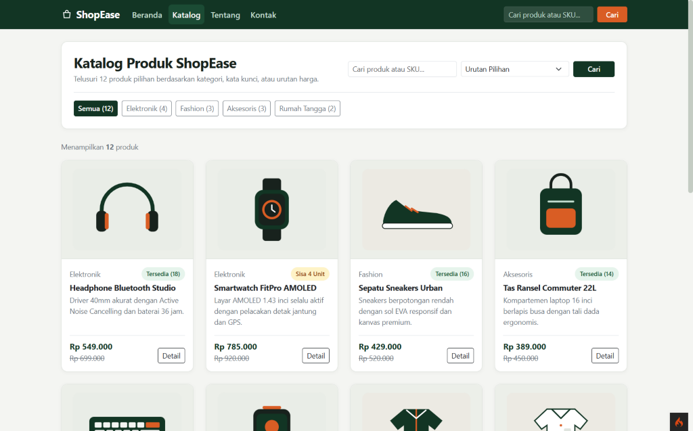
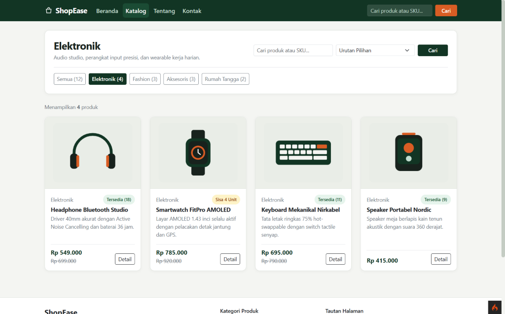
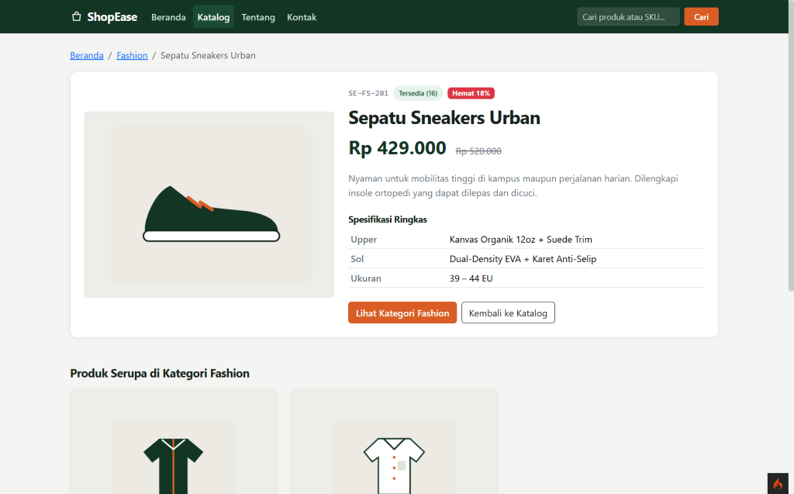
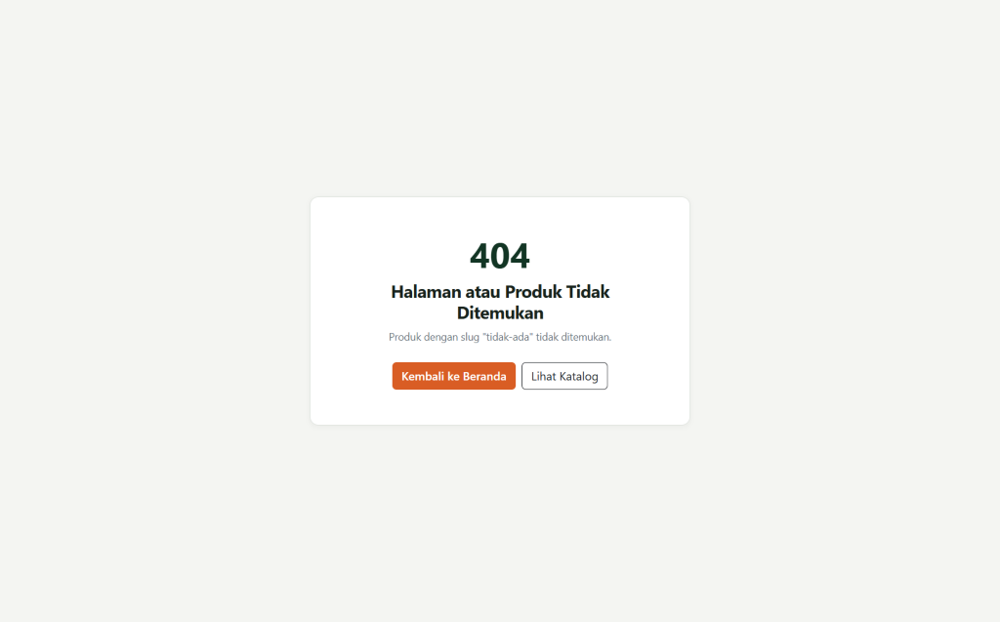
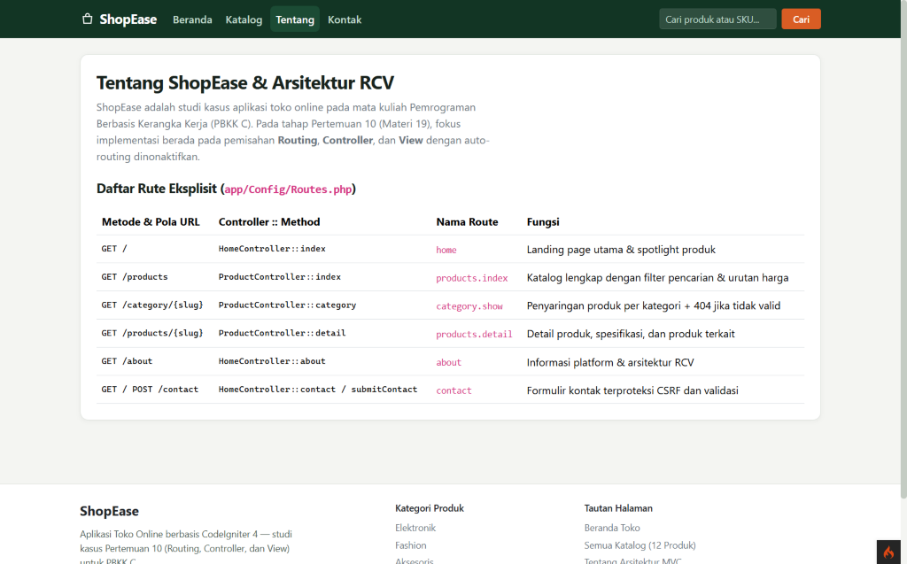
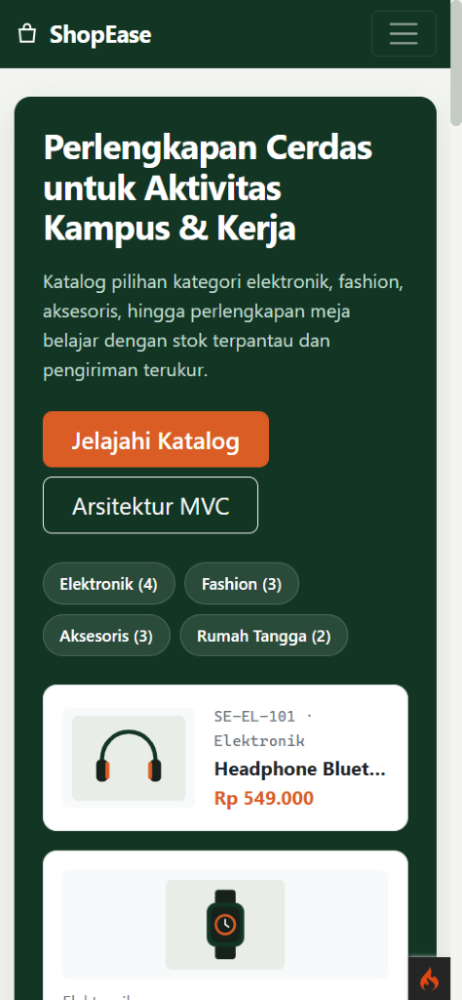

# Laporan Praktikum — Pertemuan 10 (Materi 19)

## Landing Page & Katalog E-Commerce ShopEase: Routing, Controller, dan View (MVC) CodeIgniter 4

| | |
|---|---|
| **Mata Kuliah** | Pemrograman Berbasis Kerangka Kerja (PBKK C) |
| **Topik** | MVC, Explicit Routing, Controller, View Partials, Helper, & Custom 404 (ShopEase RCV) |
| **Nama** | Abrar Maulana |
| **NRP** | 5025241125 |
| **Tools** | PHP 8.4.28, Composer 2.11.3, CodeIgniter 4.7.6, Bootstrap 5.3.3 |

---

## Tujuan Praktikum

Praktikum Pertemuan 10 mengimplementasikan **Materi 19 (`MVC dalam Code Igniter`)** sesuai **PRD & Hands-On Lab ShopEase (Modul Routing, Controller, dan View)**. Pada tahap ini, etalase publik **ShopEase** dibangun dengan arsitektur MVC yang rapi, `setAutoRoute(false)`, katalog in-memory (`CatalogData.php` sebelum integrasi database pada Pertemuan 11–12), 12 ilustrasi SVG produk lokal, serta penanganan halaman 404 kustom.

```
HTTP Request (/products/sepatu-sneakers-urban)
      │
      ▼
app/Config/Routes.php (AutoRoute = false)
      │
      ▼
ProductController::detail($slug) ◄── CatalogData (12 Produk, 4 Kategori)
      │                                     │
      ├─ Tidak ditemukan ──► PageNotFoundException ──► errors/html/error_404.php
      └─ Ditemukan       ──► views/frontend/product_detail.php
                                 ├── layouts/store.php
                                 └── partials/{navbar,product_card,footer}.php
```

Setelah praktikum, mahasiswa mampu:

- Menonaktifkan auto-routing dan menyusun named routes eksplisit di `app/Config/Routes.php`.
- Memisahkan tanggung jawab `HomeController` dan `ProductController` termasuk query string pencarian (`?q=`), kategori (`?category=`), serta pengurutan (`?sort=`).
- Membangun tampilan modular menggunakan `$this->extend()`, `$this->section()`, dan partial view reusable (`product_card.php`, `navbar.php`, `footer.php`).
- Membuat helper kustom (`shop_helper.php`: `format_rupiah`, `stock_badge`, `discount_percent`, `nav_active`) dan me-autoload-kannya di `Autoload.php`.
- Menangani rute/slug yang tidak valid dengan `PageNotFoundException` menuju halaman 404 berdesain konsisten.

---

## Struktur Folder

```
Tugas Pertemuan 10/
├── README.md                                  ← laporan praktikum ini
├── image-1.png .. image-7.png                 ← screenshot hasil pengujian (desktop & mobile)
└── ShopEase/
    ├── app/
    │   ├── Config/
    │   │   ├── App.php                        ← indexPage = '' untuk URL bersih
    │   │   ├── Autoload.php                   ← autoload helper url, form, shop
    │   │   ├── Filters.php                    ← proteksi CSRF pada metode POST
    │   │   └── Routes.php                     ← 7 named/explicit routes (AutoRoute off)
    │   ├── Controllers/
    │   │   ├── HomeController.php             ← /, /about, /contact (GET + POST)
    │   │   └── ProductController.php          ← /products, /category/{slug}, /products/{slug}
    │   ├── Helpers/
    │   │   └── shop_helper.php                ← format_rupiah(), stock_badge(), discount_percent()
    │   ├── Libraries/
    │   │   └── CatalogData.php                ← 4 kategori & 12 produk demo ShopEase
    │   └── Views/
    │       ├── layouts/store.php              ← template induk storefront
    │       ├── partials/
    │       │   ├── navbar.php                 ← navigasi utama + bilah pencarian
    │       │   ├── product_card.php           ← kartu produk reusable
    │       │   └── footer.php                 ← footer kategori & tautan halaman
    │       ├── frontend/
    │       │   ├── home.php                   ← landing page & hero showcase asimetris
    │       │   ├── products.php               ← katalog lengkap + filter & sort
    │       │   ├── product_detail.php         ← detail produk, spesifikasi, produk terkait
    │       │   ├── about.php                  ← informasi ShopEase & daftar route
    │       │   └── contact.php                ← formulir kontak tervalidasi
    │       └── errors/html/error_404.php      ← halaman 404 kustom
    ├── public/assets/
    │   ├── css/bootstrap.min.css & shopease.css
    │   ├── js/bootstrap.bundle.min.js
    │   └── images/products/*.svg              ← 12 ilustrasi vektor produk lokal
    └── env                                    ← template konfigurasi environment
```

---

## Cara Menjalankan

1. Masuk ke folder `ShopEase`, pasang dependensi, dan salin template `.env`:

   ```bash
   cd "ShopEase"
   composer install
   copy env .env
   ```

2. Jalankan server lokal CodeIgniter 4:

   ```bash
   php spark serve --port=8084
   ```

3. Buka `http://localhost:8084` di browser. (Tahap Pertemuan 10 belum memerlukan database karena katalog menggunakan `app/Libraries/CatalogData.php`.)

---

## Step 1 — Pemetaan Rute Eksplisit (`app/Config/Routes.php`)

Seluruh akses URL dipetakan secara eksplisit dan auto-routing dimatikan agar tidak ada method controller yang terbuka tanpa izin:

```php
$routes->setAutoRoute(false);

$routes->get('/', 'HomeController::index', ['as' => 'home']);
$routes->get('about', 'HomeController::about', ['as' => 'about']);
$routes->get('contact', 'HomeController::contact', ['as' => 'contact']);
$routes->post('contact', 'HomeController::submitContact');

$routes->get('products', 'ProductController::index', ['as' => 'products.index']);
$routes->get('products/(:segment)', 'ProductController::detail/$1', ['as' => 'products.detail']);
$routes->get('category/(:segment)', 'ProductController::category/$1', ['as' => 'category.show']);
```

| Rute | Controller :: Method | Deskripsi |
|---|---|---|
| `GET /` | `HomeController::index` | Landing page hero showcase, 4 kategori, dan 8 produk pilihan |
| `GET /products` | `ProductController::index` | Katalog lengkap 12 produk dengan parameter `?q=`, `?category=`, `?sort=` |
| `GET /category/(:segment)` | `ProductController::category/$1` | Filter produk berdasarkan slug kategori (404 jika tidak ditemukan) |
| `GET /products/(:segment)` | `ProductController::detail/$1` | Halaman detail produk, spesifikasi, diskon, dan produk terkait |
| `GET /about` | `HomeController::about` | Ringkasan arsitektur RCV dan daftar route |
| `GET / POST /contact` | `HomeController::contact` / `submitContact` | Form layanan pelanggan dengan proteksi CSRF dan validasi input |



---

## Step 2 — Helper, Controller Katalog, dan Penanganan 404

`app/Helpers/shop_helper.php` menyediakan helper tampilan konsisten (`format_rupiah`, `stock_badge`, `discount_percent`, `nav_active`), sedangkan `ProductController` menangani filter serta melempar `PageNotFoundException` untuk slug tidak dikenal:

```php
// app/Controllers/ProductController.php — detail produk dengan fallback 404
public function detail(string $slug): string
{
    $product = CatalogData::findProductBySlug($slug);
    if (! $product) {
        throw PageNotFoundException::forPageNotFound("Produk dengan slug \"{$slug}\" tidak ditemukan.");
    }
    ...
}
```







---

## Step 3 — Pengujian Seluruh Alur & Responsif

Seluruh rute, fitur pencarian/filter/sortir, validasi form kontak, penanganan 404, aset SVG lokal, serta tata letak responsif (`1366×850` desktop dan `390×844` mobile) telah diuji langsung di browser:

| No | Skenario Pengujian | Hasil yang Diharapkan | Status |
|---|---|---|---|
| 1 | Akses Landing Page `/` (`1366×850`) | Hero showcase, 4 kategori, 8 produk pilihan, dan footer tampil tanpa overflow | ✅ |
| 2 | Akses Katalog `/products` (12 produk) | Seluruh 12 ilustrasi SVG produk termuat (`HTTP 200`) dengan proporsi rapi | ✅ |
| 3 | Pencarian `?q=sepatu` & `?q=tidakadakata` | Menampilkan 1 produk (`Sepatu Sneakers Urban`) dan tampilan *empty state* bersih | ✅ |
| 4 | Pengurutan `?sort=price_asc` | Produk termurah (`Dompet Kulit Minimalis` Rp 185.000) muncul paling awal | ✅ |
| 5 | Rute kategori `/category/elektronik` | Menampilkan tepat 4 produk kategori Elektronik | ✅ |
| 6 | Detail `/products/sepatu-sneakers-urban` | Menampilkan SKU `SE-FS-201`, diskon `Hemat 18%`, spesifikasi, & produk terkait | ✅ |
| 7 | Akses slug tidak ada `/products/tidak-ada` | Mengembalikan status `HTTP 404` dengan tampilan halaman 404 kustom ShopEase | ✅ |
| 8 | Form `POST /contact` & halaman `/about` | Validasi & CSRF berhasil dengan pesan konfirmasi; tabel rute tampil di `/about` | ✅ |
| 9 | Uji responsif mobile (`390×844`) | Zero horizontal overflow dan teks kartu spotlight terpotong rapi | ✅ |






