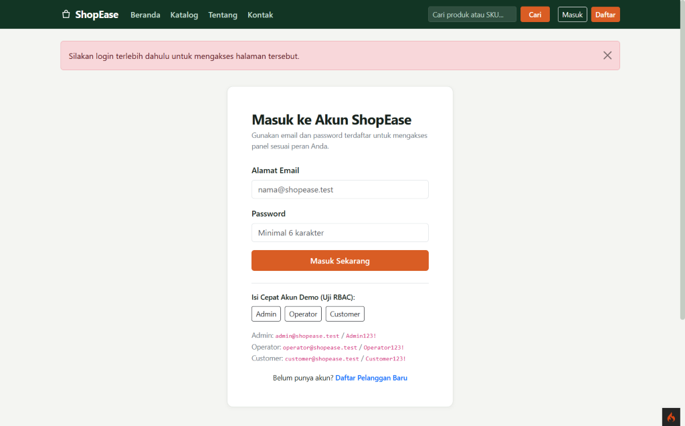
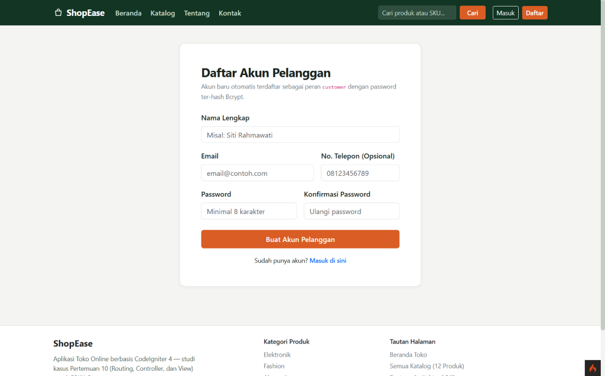
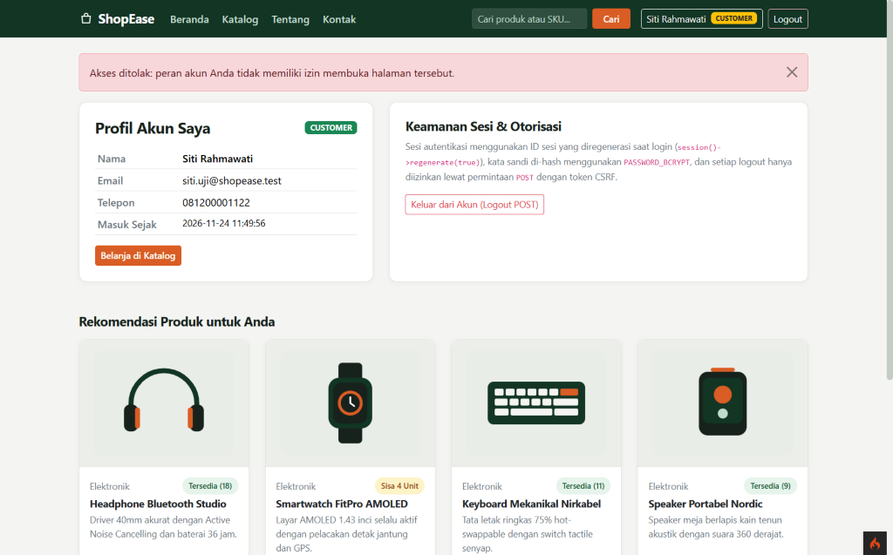
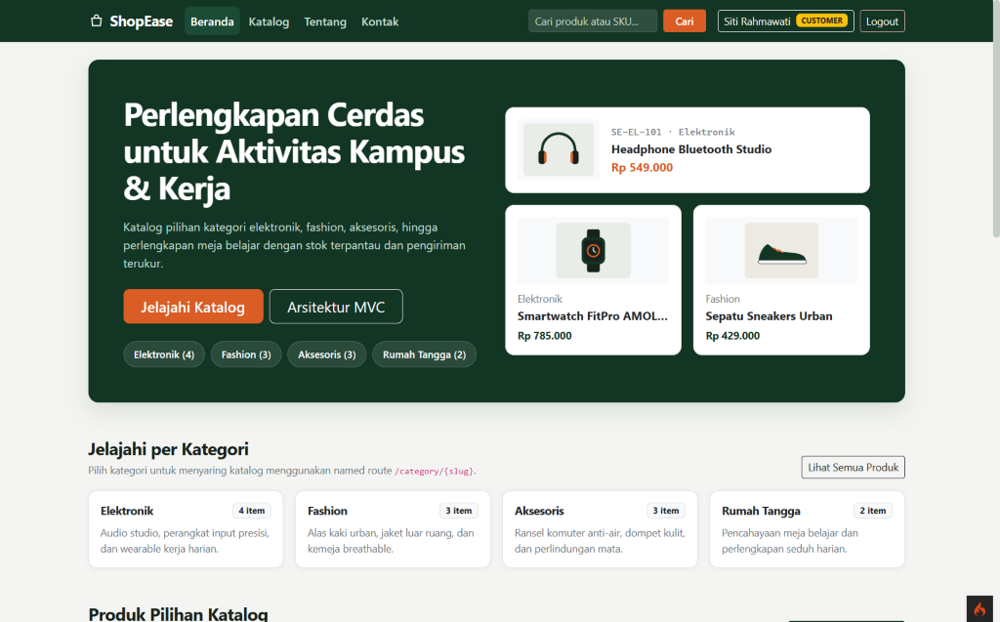
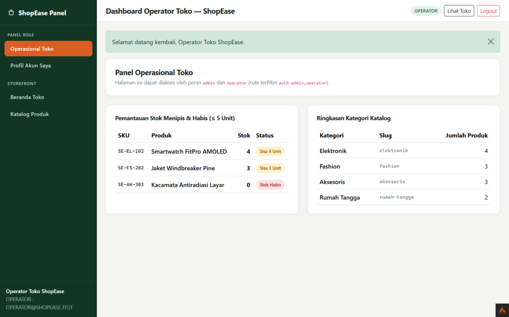
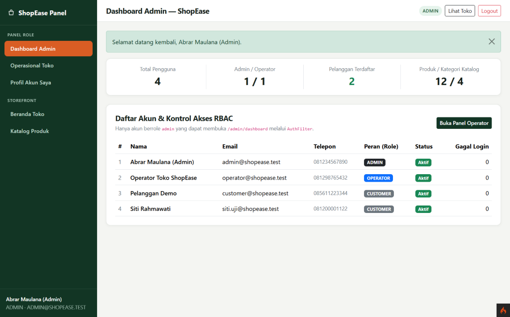
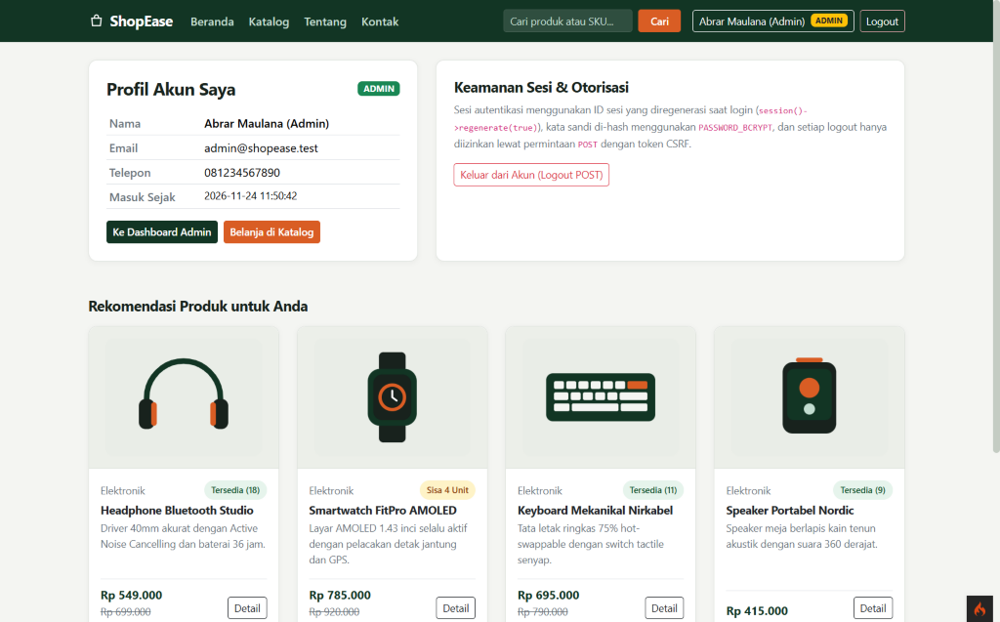

# Laporan Praktikum — Pertemuan 11 (Materi 23)

## Model & Sistem Autentikasi ShopEase: Register, Login, Session, & RBAC (`AuthFilter`) di CodeIgniter 4

| | |
|---|---|
| **Mata Kuliah** | Pemrograman Berbasis Kerangka Kerja (PBKK C) |
| **Topik** | Model Database, Migration, Seeder, Autentikasi Bcrypt, Session Security, & RBAC (`AuthFilter`) |
| **Nama** | Abrar Maulana |
| **NRP** | 5025241125 |
| **Tools** | PHP 8.4.28, Composer 2.11.3, CodeIgniter 4.7.6, Bootstrap 5.3.3, SQLite3 / MySQL |

---

## Tujuan Praktikum

Praktikum Pertemuan 11 mengimplementasikan **Materi 23 (`Model dalam CI`)** sesuai **`Hands-On_Lab_Authentication_System_CodeIgniter_4.docx`** pada proyek **ShopEase**. Tahap ini menghubungkan storefront Pertemuan 10 dengan basis data pengguna (`users`), `UserModel`, `AuthController`, proteksi rute `AuthFilter` & `GuestFilter`, serta pemisahan dashboard peran (`admin`, `operator`, `customer`).

```
Request (/admin/dashboard)
      │
      ▼
app/Filters/AuthFilter (auth:admin)
      ├─ Belum login        ──► Redirect /login + flash error
      ├─ Role ≠ 'admin'     ──► Redirect ke dashboard peran masing-masing + flash ditolak
      └─ Role = 'admin'     ──► Admin\DashboardController::index
```

Setelah praktikum, mahasiswa mampu:

- Membuat migrasi dan seeder tabel `users` (`role`: `admin`, `operator`, `customer`) pada SQLite3 maupun MySQL (`db_shopease`).
- Mengimplementasikan registrasi pelanggan dengan validasi email unik, hashing password `PASSWORD_BCRYPT`, dan konfirmasi sandi.
- Mengamankan login dengan `password_verify()`, regenerasi session ID (`session()->regenerate(true)`), dan pembatasan percobaan gagal (5× gagal → kunci sementara 60 detik).
- Memastikan logout hanya berjalan via metode `POST` terproteksi token CSRF.
- Menerapkan *Role-Based Access Control* (RBAC) dengan `AuthFilter` dan `GuestFilter` pada `app/Config/Filters.php` dan `Routes.php`.

---

## Struktur Folder

```
Tugas Pertemuan 11/
├── README.md                                  ← laporan praktikum ini
├── image-1.png .. image-7.png                 ← screenshot hasil pengujian autentikasi & RBAC
├── Database/
│   └── db_shopease.sql                        ← skema & 3 akun demo MySQL (`db_shopease`)
└── ShopEase/
    ├── app/
    │   ├── Config/
    │   │   ├── Filters.php                    ← alias auth, guest, & CSRF metode POST
    │   │   └── Routes.php                     ← grup rute guest, auth, admin, operator
    │   ├── Controllers/
    │   │   ├── AuthController.php             ← login, register, logout (POST + CSRF)
    │   │   ├── AccountController.php          ← halaman /account (customer/all roles)
    │   │   ├── Admin/DashboardController.php  ← /admin/dashboard (khusus admin)
    │   │   └── Operator/DashboardController.php ← /operator/dashboard (admin & operator)
    │   ├── Database/
    │   │   ├── Migrations/2026-11-11-000001_CreateUsers.php
    │   │   └── Seeds/UserSeeder.php           ← 3 akun demo (admin, operator, customer)
    │   ├── Filters/
    │   │   ├── AuthFilter.php                 ← verifikasi login & argumen role RBAC
    │   │   └── GuestFilter.php                ← pengalihan user yang sudah login
    │   ├── Models/
    │   │   └── UserModel.php                  ← findByEmail, lockout 5 percobaan, statistik role
    │   └── Views/
    │       ├── layouts/dashboard.php          ← shell panel operator/admin dengan sidebar
    │       ├── partials/navbar.php            ← navbar dinamis (Masuk/Daftar vs Badge + Logout)
    │       ├── auth/{login,register}.php      ← form autentikasi & tombol cepat akun demo
    │       ├── admin/dashboard.php            ← statistik user & tabel RBAC
    │       ├── operator/dashboard.php         ← pantauan stok menipis & kategori
    │       └── account/index.php              ← profil pelanggan & status keamanan sesi
    └── env                                    ← template konfigurasi SQLite3 / MySQLi
```

---

## Cara Menjalankan

1. Masuk ke folder `ShopEase`, pasang dependensi, dan salin template `.env`:

   ```bash
   cd "ShopEase"
   composer install
   copy env .env
   ```

2. **(Opsional MySQL)** Impor `Database/db_shopease.sql` ke MySQL dan aktifkan konfigurasi `MySQLi` di `.env`. Jika memakai mode **SQLite3** bawaan, langsung lanjut ke langkah 3.

3. Jalankan migrasi, seeder akun demo, dan server lokal:

   ```bash
   php spark migrate
   php spark db:seed UserSeeder
   php spark serve --port=8085
   ```

4. Akses `http://localhost:8085/login` dengan akun demo berikut:

| Peran (`role`) | Email | Password | Tujuan Redirect Setelah Login |
|---|---|---|---|
| **Admin** | `admin@shopease.test` | `Admin123!` | `/admin/dashboard` |
| **Operator** | `operator@shopease.test` | `Operator123!` | `/operator/dashboard` |
| **Customer** | `customer@shopease.test` | `Customer123!` | `/account` |

---

## Step 1 — Skema `users`, `UserModel`, dan Perlindungan Brute-Force

`UserModel` menangani pencarian berdasarkan email (`findByEmail()`), pengecekan kunci sementara (`isLocked()`), dan pencatatan percobaan gagal (`recordFailedAttempt()`): jika gagal 5 kali berturut-turut, akun terkunci selama 60 detik dan direset otomatis saat berhasil login.

```php
// app/Models/UserModel.php — pencatatan kegagalan login & lockout 60 detik
public function recordFailedAttempt(array $user): int
{
    $attempts = ((int) ($user['failed_attempts'] ?? 0)) + 1;
    $update   = ['failed_attempts' => $attempts];

    if ($attempts >= self::MAX_FAILED_ATTEMPTS) {
        $update['locked_until'] = date('Y-m-d H:i:s', time() + self::LOCKOUT_SECONDS);
    }

    $this->update((int) $user['id'], $update);
    return $attempts;
}
```





---

## Step 2 — Matriks RBAC & `AuthFilter`

Rute-rute terproteksi dipetakan di `app/Config/Routes.php` menggunakan filter `auth` berargumen peran:

```php
// app/Config/Routes.php — pemetaan akses per role
$routes->get('account', 'AccountController::index', ['filter' => 'auth:customer,admin,operator']);
$routes->group('operator', ['filter' => 'auth:admin,operator'], static function ($routes) {
    $routes->get('dashboard', 'Operator\DashboardController::index', ['as' => 'operator.dashboard']);
});
$routes->group('admin', ['filter' => 'auth:admin'], static function ($routes) {
    $routes->get('dashboard', 'Admin\DashboardController::index', ['as' => 'admin.dashboard']);
});
```

| Rute | Guest (Belum Login) | Customer | Operator | Admin |
|---|---|---|---|---|
| `/`, `/products`, `/about`, `/contact` | ✅ Diizinkan | ✅ Diizinkan | ✅ Diizinkan | ✅ Diizinkan |
| `/login`, `/register` (`guest`) | ✅ Diizinkan | ↪️ `/account` | ↪️ `/operator/dashboard` | ↪️ `/admin/dashboard` |
| `/account` (`auth:customer,admin,operator`) | 🔒 `/login` | ✅ Diizinkan | ✅ Diizinkan | ✅ Diizinkan |
| `/operator/dashboard` (`auth:admin,operator`) | 🔒 `/login` | ⛔ Ditolak | ✅ Diizinkan | ✅ Diizinkan |
| `/admin/dashboard` (`auth:admin`) | 🔒 `/login` | ⛔ Ditolak | ⛔ Ditolak | ✅ Diizinkan |





---

## Step 3 — Tabel Verifikasi 8 Skenario Hands-On Lab Authentication

| No | Skenario Pengujian | Hasil yang Diharapkan | Status |
|---|---|---|---|
| 1 | Guest akses `/admin/dashboard` | Dialihkan ke `/login` dengan pesan peringatan wajib login | ✅ |
| 2 | Registrasi pelanggan baru (`siti.uji@shopease.test`) | Akun tersimpan dengan password bcrypt, redirect ke `/login` + pesan sukses | ✅ |
| 3 | Registrasi ulang dengan email yang sama | Ditolak dengan pesan `"Email ... sudah terdaftar"` | ✅ |
| 4 | Login dengan password salah (`Salah123!`) | Ditolak dan menampilkan sisa percobaan (`Sisa percobaan: 4`) | ✅ |
| 5 | Customer coba buka `/admin/dashboard` & `/operator/dashboard` | Ditolak `AuthFilter`, kembali ke `/account` dengan pesan `"Akses ditolak"` | ✅ |
| 6 | Operator login & akses `/operator/dashboard` vs `/admin/dashboard` | Masuk ke panel operator; akses ke `/admin/dashboard` ditolak | ✅ |
| 7 | Admin login & akses `/admin/dashboard` + `/account` | Menampilkan 4 pengguna beserta peran dan status aktif | ✅ |
| 8 | Klik tombol `Logout` (`POST /logout` + CSRF) | Sesi dihapus, redirect ke `/`, dan navbar kembali ke `Masuk` / `Daftar` | ✅ |






