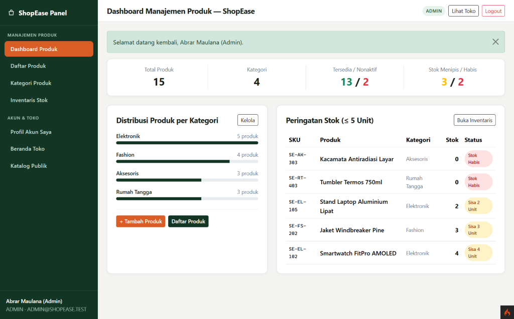
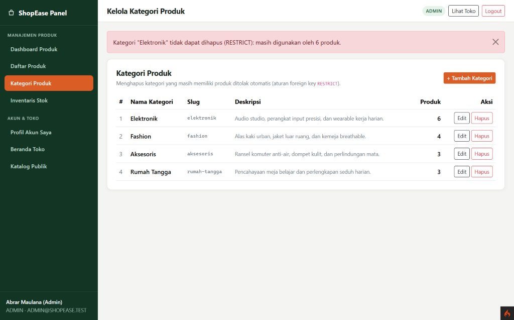
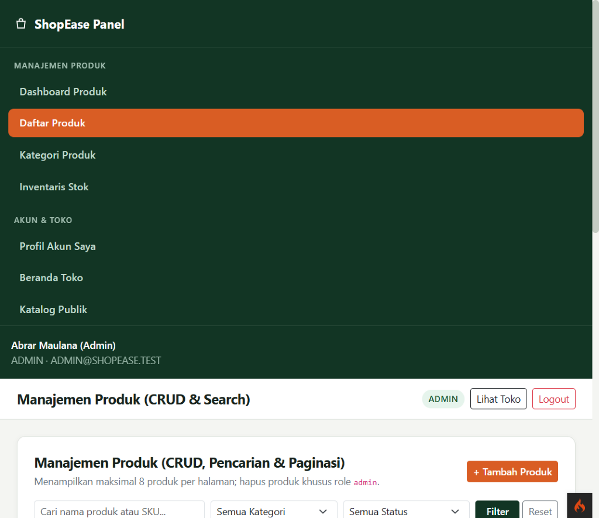
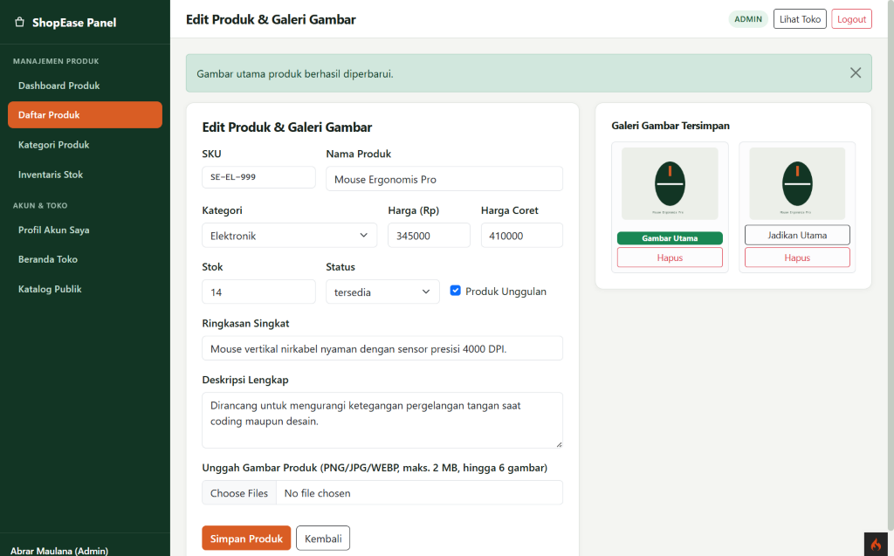
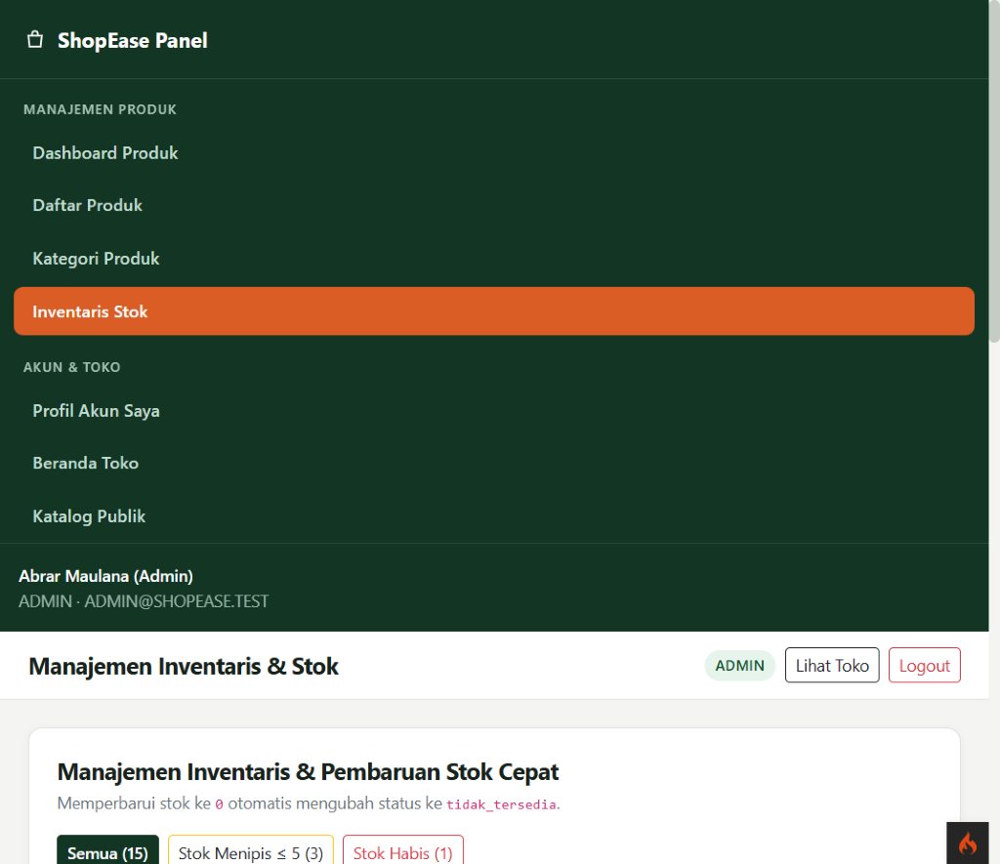
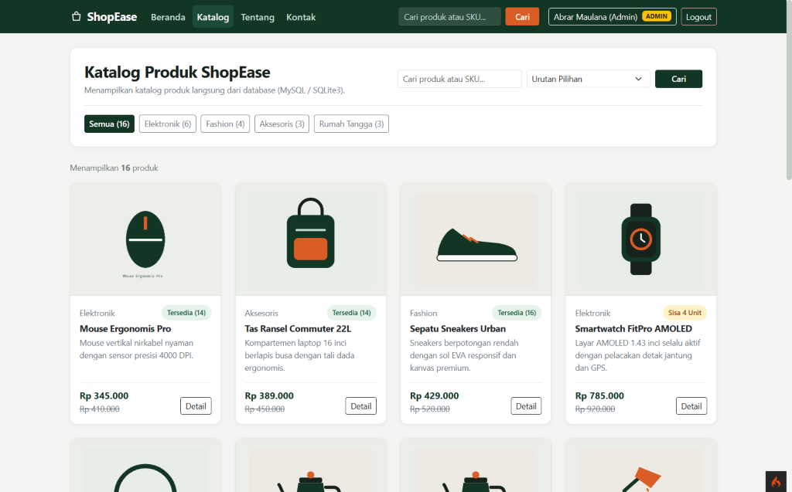
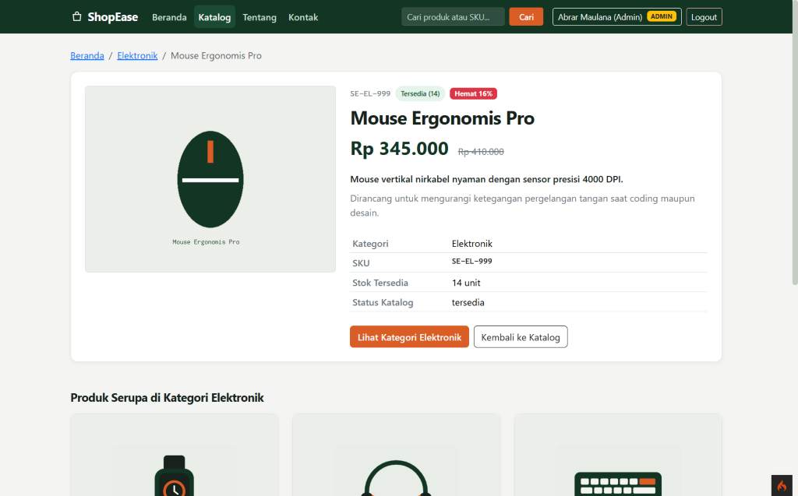
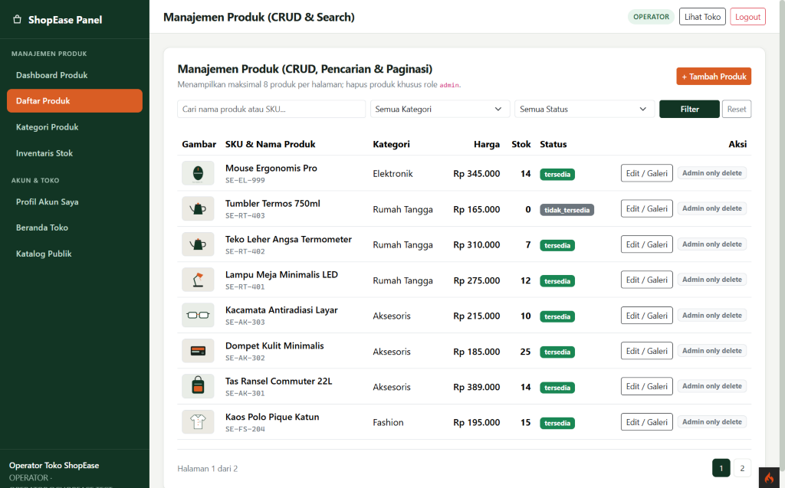

# Laporan Praktikum — Pertemuan 12 (Materi 24)

## Product Management CRUD, Multi-Image Gallery, Search, & Inventory ShopEase di CodeIgniter 4

| | |
|---|---|
| **Mata Kuliah** | Pemrograman Berbasis Kerangka Kerja (PBKK C) |
| **Topik** | Relational CRUD (`categories`, `products`, `product_images`), File Upload Gallery, Search/Pagination, Inventory, & RBAC |
| **Nama** | Abrar Maulana |
| **NRP** | 5025241125 |
| **Tools** | PHP 8.4.28, Composer 2.11.3, CodeIgniter 4.7.6, Bootstrap 5.3.3, SQLite3 / MySQL |

---

## Tujuan Praktikum

Praktikum Pertemuan 12 mengimplementasikan **Materi 24 (`Model dan CRUD dalam Framework`)** sesuai **`HOL_Product_Management_ShopEase_CI4.docx`** beserta seluruh **4 Tugas Pengembangan Mahasiswa** (Product Search, Product Image Gallery, Inventory Management, dan Dashboard Product). Modul ini menyambungkan panel admin/operator dengan storefront publik **ShopEase** langsung ke database relasional.

```
categories (1) ──[RESTRICT]──◄ products (N) ──[CASCADE]──◄ product_images (N)
                                   │
           ┌───────────────────────┼───────────────────────┐
           ▼                       ▼                       ▼
   Admin\ProductController   Admin\InventoryController  Storefront Publik
   (CRUD, Upload, Search)    (Stok Menipis / Habis)     (/, /products, /detail)
```

Setelah praktikum, mahasiswa mampu:

- Merancang migrasi relasional (`categories`, `products`, `product_images`) dengan aturan foreign key `ON DELETE RESTRICT` pada kategori dan `ON DELETE CASCADE` pada galeri gambar.
- Membangun CRUD Kategori dan Produk lengkap dengan slug unik otomatis (`unique_slug()`), validasi server-side, dan proteksi CSRF.
- Mengimplementasikan keempat tugas pengembangan HOL: **Product Search + Paginasi**, **Multi-Image Upload & Primary Fallback**, **Inventory Low-Stock Management**, serta **Dashboard Produk**.
- Menerapkan pemisahan hak akses RBAC: `admin` dan `operator` dapat mengelola katalog dan stok, sedangkan aksi hapus (`delete`) hanya diizinkan untuk `admin`.

---

## Struktur Folder

```
Tugas Pertemuan 12/
├── README.md                                  ← laporan praktikum ini
├── image-1.png .. image-8.png                 ← screenshot hasil pengujian CRUD & storefront
├── Database/
│   └── db_shopease.sql                        ← skema lengkap & seed 4 kategori, 15 produk, 3 akun
└── ShopEase/
    ├── app/
    │   ├── Config/Routes.php                  ← rute storefront, auth, management, & admin-only delete
    │   ├── Controllers/
    │   │   ├── HomeController.php             ← landing page langsung dari DB
    │   │   ├── ProductController.php          ← katalog, filter kategori, & galeri detail produk DB
    │   │   └── Admin/
    │   │       ├── DashboardController.php    ← Tugas 4: statistik produk, bar kategori, alert stok
    │   │       ├── CategoryController.php     ← CRUD kategori + guard RESTRICT
    │   │       ├── ProductController.php      ← Tugas 1 (Search/Pagination) & Tugas 2 (Multi-Image)
    │   │       └── InventoryController.php    ← Tugas 3: filter stok <= 5 & update stok instan
    │   ├── Database/
    │   │   ├── Migrations/
    │   │   │   ├── 2026-11-11-000001_CreateUsers.php
    │   │   │   └── 2026-11-20-000001_CreateProductManagementTables.php
    │   │   └── Seeds/
    │   │       ├── UserSeeder.php
    │   │       └── DatabaseSeeder.php         ← seed 3 user, 4 kategori, 15 produk, 15 gambar awal
    │   ├── Helpers/shop_helper.php            ← format_rupiah, stock_badge, unique_slug
    │   ├── Models/
    │   │   ├── CategoryModel.php              ← getWithProductCount, hasProducts
    │   │   ├── ProductModel.php               ← getAdminProducts, getPublicCatalog, getInventoryList, stats
    │   │   └── ProductImageModel.php          ← getByProduct, setPrimary, deleteWithFallback
    │   └── Views/
    │       ├── frontend/                      ← terhubung langsung ke Model database
    │       └── admin/
    │           ├── dashboard.php              ← Dashboard Produk
    │           ├── categories/{index,form}.php
    │           ├── products/{index,form}.php  ← pencarian, paginasi, upload & preview galeri
    │           └── inventory/index.php        ← filter stok menipis/habis & quick-update stok
    ├── public/uploads/products/               ← direktori upload + .htaccess proteksi eksekusi
    └── env                                    ← template konfigurasi SQLite3 / MySQLi
```

---

## Cara Menjalankan

1. Masuk ke folder `ShopEase`, pasang dependensi, dan salin template `.env`:

   ```bash
   cd "ShopEase"
   composer install
   copy env .env
   ```

2. **(Opsional MySQL)** Impor `Database/db_shopease.sql` ke MySQL dan aktifkan konfigurasi `MySQLi` di `.env`. Jika memakai mode **SQLite3** bawaan, langsung lanjut ke langkah 3.

3. Jalankan migrasi, seeder lengkap (`DatabaseSeeder`), dan server lokal:

   ```bash
   php spark migrate
   php spark db:seed DatabaseSeeder
   php spark serve --port=8086
   ```

4. Login di `http://localhost:8086/login` memakai akun **Admin** (`admin@shopease.test` / `Admin123!`) atau **Operator** (`operator@shopease.test` / `Operator123!`).

---

## Step 1 — Dashboard Produk & Aturan Relasi (`Tugas 4` + `RESTRICT`)

`Admin\DashboardController` menampilkan ringkasan total produk, total kategori, perbandingan status `tersedia` vs `tidak_tersedia`, produk stok menipis (`<= 5`) / stok habis (`0`), grafik batang proporsi per kategori, serta daftar peringatan stok kritis.



Pada manajemen kategori (`Admin\CategoryController::delete`), kategori yang masih dirujuk oleh tabel `products` tidak diizinkan untuk dihapus demi menjaga integritas referensial (`ON DELETE RESTRICT`):

```php
// app/Controllers/Admin/CategoryController.php — penjagaan RESTRICT
$productCount = $model->hasProducts($id);
if ($productCount > 0) {
    return redirect()->to(site_url('admin/categories'))
        ->with('error', "Kategori \"{$category['name']}\" tidak dapat dihapus (RESTRICT): masih digunakan oleh {$productCount} produk.");
}
```



---

## Step 2 — Pencarian, Paginasi, & Galeri Multi-Gambar (`Tugas 1 & 2`)

- **Tugas 1 (Product Search & Pagination):** `ProductModel::getAdminProducts()` mendukung pencarian nama/SKU (escaping `LIKE`), filter kategori, filter status, dan paginasi `8` item per halaman.
- **Tugas 2 (Product Image Gallery):** Form tambah/ubah produk mendukung unggah banyak gambar sekaligus (`PNG/JPG/WEBP`, maks. 2 MB, maks. 6 gambar/produk) dengan pratinjau langsung di browser sebelum disimpan, penentuan `Jadikan Utama`, serta penghapusan gambar dengan auto-fallback `ProductImageModel::deleteWithFallback()`.





---

## Step 3 — Manajemen Inventaris & Integrasi Storefront (`Tugas 3` + Pengujian)

`Admin\InventoryController` mempermudah filter **Semua**, **Stok Menipis (≤ 5)**, dan **Stok Habis (0)** beserta form pembaruan stok per baris yang otomatis menyinkronkan status `tersedia` / `tidak_tersedia`. Perubahan langsung tampil pada storefront publik (`/products` dan `/products/{slug}`).

| No | Skenario Pengujian | Hasil yang Diharapkan | Status |
|---|---|---|---|
| 1 | Dashboard Produk (`/admin/dashboard`) | Menampilkan 15 produk awal, 4 kategori, bar distribusi, & peringatan stok | ✅ |
| 2 | Search, Filter & Paginasi (`/admin/products`) | Halaman 1 (8 item), halaman 2 (7 item), cari `Headphone` (1 hasil) | ✅ |
| 3 | Tambah `Mouse Ergonomis Pro` + Upload PNG | Preview tampil, file tersimpan di `public/uploads/products/`, jumlah produk jadi 16 | ✅ |
| 4 | Multi-upload, `Jadikan Utama`, & Hapus gambar | Unggah gambar ke-2, set primary sukses, dan hapus gambar bekerja bersih | ✅ |
| 5 | Hapus kategori `Elektronik` vs `Uji Kategori` | `Elektronik` ditolak (`RESTRICT`), sedangkan kategori kosong berhasil dihapus | ✅ |
| 6 | Update stok `Kacamata Antiradiasi Layar` (`0 → 10`) | Status otomatis berubah dari `tidak_tersedia` menjadi `tersedia` | ✅ |
| 7 | Storefront publik (`/products` & `/products/mouse-ergonomis-pro`) | Produk baru & gambar upload PNG dari DB tampil sempurna (`HTTP 200`) | ✅ |
| 8 | Login Operator (`operator@shopease.test`) | Bisa akses `/admin/products` & `/admin/inventory`, tombol hapus terkunci (`auth:admin`) | ✅ |








