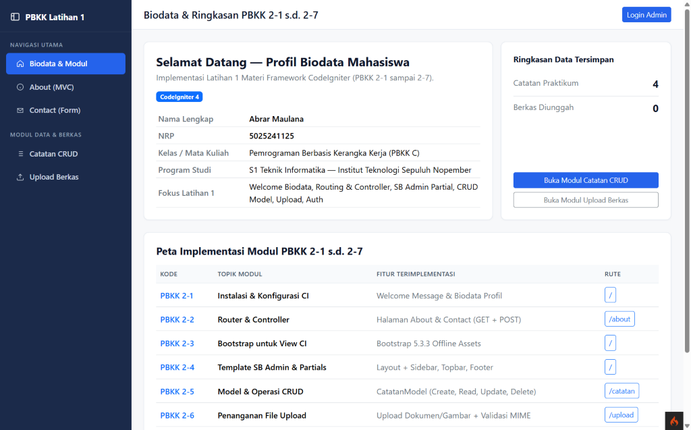
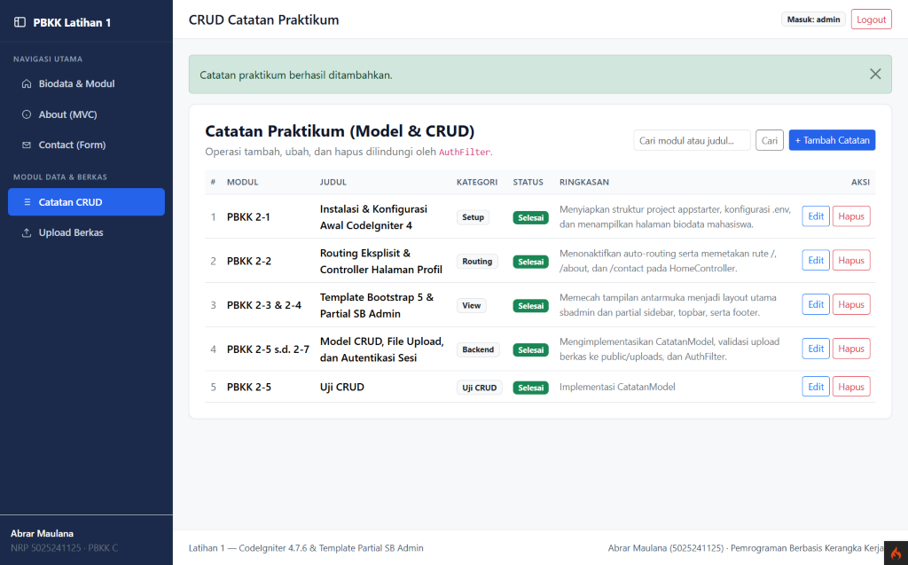
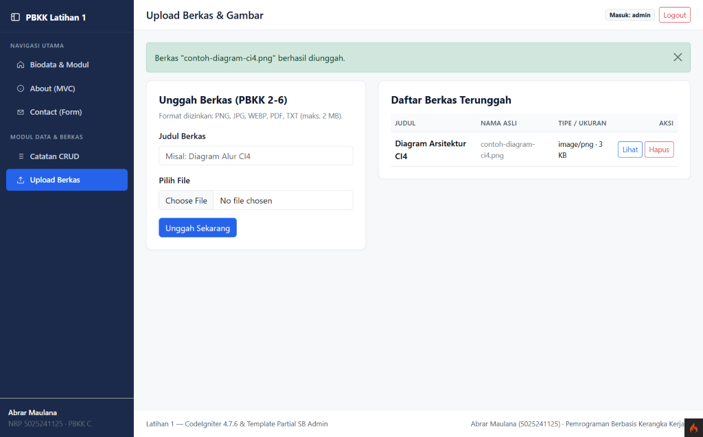
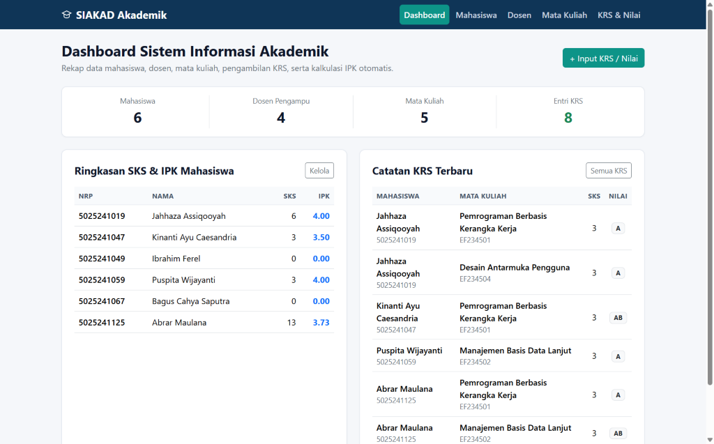
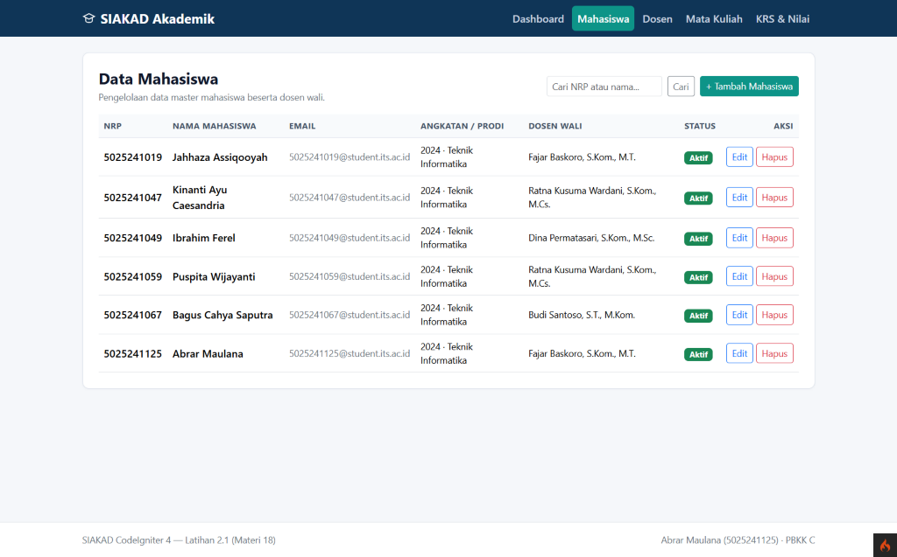
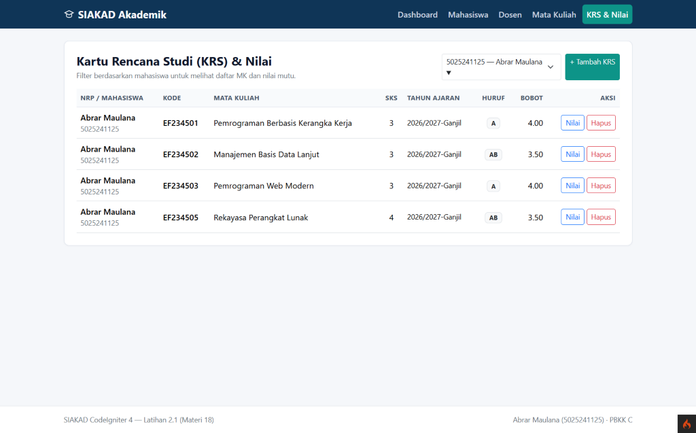
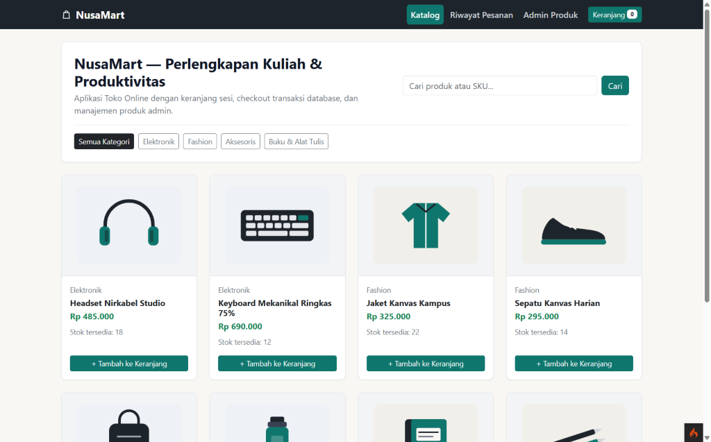
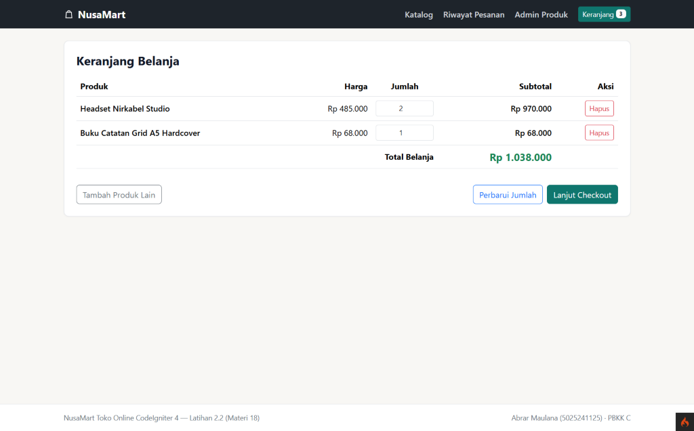
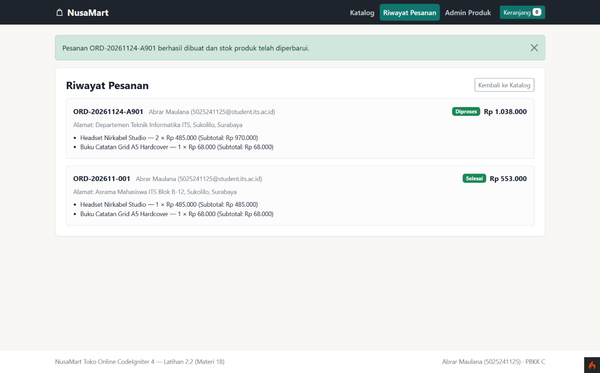

# Laporan Praktikum — Pertemuan 9 (Materi 18)

## Pengenalan Framework CodeIgniter 4: Latihan 1 (PBKK 2-1 s.d. 2-7) & Latihan 2 (SIAKAD + Toko Online)

| | |
|---|---|
| **Mata Kuliah** | Pemrograman Berbasis Kerangka Kerja (PBKK C) |
| **Topik** | Framework CodeIgniter 4, Routing, Partial View, Model CRUD, File Upload, Autentikasi Sesi |
| **Nama** | Abrar Maulana |
| **NRP** | 5025241125 |
| **Tools** | PHP 8.4.28, Composer 2.11.3, CodeIgniter 4.7.6, Bootstrap 5.3.3, SQLite3 / MySQL |

---

## Tujuan Praktikum

Praktikum Pertemuan 9 mengikuti **Materi 18 (`Menggunakan Framework Code Igniter`)** yang terdiri dari dua rangkaian latihan: **Latihan 1** mempelajari fondasi CodeIgniter melalui tujuh modul (`PBKK 2-1` s.d. `2-7`), dan **Latihan 2** membangun dua studi kasus terpisah berupa **Sistem Informasi Akademik (SIAKAD)** serta **Toko Online (NusaMart)**.

```
Tugas Pertemuan 9
├── Latihan 1  ──► Biodata + Routing + SB Admin Partial + CRUD + Upload + AuthFilter
└── Latihan 2
    ├── 2.1 SIAKAD     ──► Mahasiswa, Dosen, Mata Kuliah, KRS & Kalkulasi IPK
    └── 2.2 TokoOnline ──► Katalog, Keranjang Sesi, Checkout Transaksi, Admin Produk
```

Setelah praktikum, mahasiswa mampu:

- Menyiapkan proyek CodeIgniter 4 menggunakan Composer (`codeigniter4/appstarter`) serta mengonfigurasi `.env` (SQLite3 maupun MySQL).
- Mengonfigurasi routing eksplisit (`setAutoRoute(false)`) dan memisahkan layout beserta partial view (`sidebar`, `topbar`, `footer`).
- Membangun Model, Migration, Seeder, dan operasi CRUD lengkap dengan validasi server-side dan proteksi CSRF.
- Menangani file upload dengan validasi ekstensi/ukuran serta membatasi rute sensitif menggunakan `AuthFilter`.
- Mengimplementasikan relasi tabel akademik (SIAKAD) serta transaksi keranjang dan checkout toko online (NusaMart).

---

## Struktur Folder

```
Tugas Pertemuan 9/
├── README.md                              ← laporan praktikum ini
├── image-1.png .. image-9.png             ← screenshot hasil pengujian aplikasi
├── Database/
│   ├── db_biodata.sql                     ← skema & seed MySQL untuk Latihan 1
│   ├── db_siakad.sql                      ← skema & seed MySQL untuk SIAKAD
│   └── db_tokoonline.sql                  ← skema & seed MySQL untuk NusaMart
├── Latihan1-Biodata/                      ← proyek CI4 Latihan 1 (PBKK 2-1 s.d. 2-7)
│   ├── app/Config/                        ← Routes.php, Filters.php, App.php, Database.php
│   ├── app/Controllers/                   ← HomeController, AuthController, CatatanController, UploadController
│   ├── app/Database/Migrations & Seeds/   ← CreateBiodataTables, BiodataSeeder
│   ├── app/Filters/AuthFilter.php         ← proteksi rute CRUD & upload
│   ├── app/Models/                        ← CatatanModel, BerkasModel, UserModel
│   ├── app/Views/                         ← layouts/sbadmin.php, partials/, pages/
│   ├── public/assets/ & uploads/          ← Bootstrap 5.3.3 lokal + CSS + folder unggah
│   └── env                                ← template konfigurasi SQLite3 / MySQLi
├── Latihan2-SIAKAD/                       ← proyek CI4 Latihan 2.1 (SIAKAD)
│   ├── app/Controllers/                   ← Dashboard, Mahasiswa, Dosen, MataKuliah, KrsController
│   ├── app/Database/Migrations & Seeds/   ← CreateSiakadTables, SiakadSeeder
│   ├── app/Models/                        ← DosenModel, MahasiswaModel, MataKuliahModel, KrsModel
│   ├── app/Views/                         ← layouts/siakad.php, dashboard.php, mahasiswa/, dosen/, matakuliah/, krs/
│   └── env                                ← template konfigurasi SQLite3 / MySQLi
└── Latihan2-TokoOnline/                   ← proyek CI4 Latihan 2.2 (NusaMart)
    ├── app/Controllers/                   ← StoreController, CartController, AdminProductController
    ├── app/Database/Migrations & Seeds/   ← CreateTokoOnlineTables, TokoOnlineSeeder
    ├── app/Models/                        ← CategoryModel, ProductModel, OrderModel
    ├── app/Views/                         ← layouts/store.php, store/, admin/
    ├── public/assets/images/              ← 8 ilustrasi SVG produk lokal
    └── env                                ← template konfigurasi SQLite3 / MySQLi
```

---

## Cara Menjalankan

Setiap sub-proyek sudah dikonfigurasi agar langsung berjalan memakai **SQLite3** (tanpa perlu server MySQL tambahan), namun juga menyediakan skrip `.sql` dan konfigurasi **MySQLi** apabila ingin dijalankan lewat XAMPP/MySQL.

1. Masuk ke salah satu folder proyek (`Latihan1-Biodata`, `Latihan2-SIAKAD`, atau `Latihan2-TokoOnline`):

   ```bash
   cd "Latihan1-Biodata"
   composer install
   copy env .env
   ```

2. **(Opsional MySQL)** Impor skrip di `Database/` (`db_biodata.sql`, `db_siakad.sql`, atau `db_tokoonline.sql`), lalu aktifkan baris konfigurasi `MySQLi` di file `.env`. Jika memakai mode **SQLite3** bawaan, langsung lanjut ke langkah 3.

3. Jalankan migrasi, seeder, dan server lokal CodeIgniter 4:

   ```bash
   php spark migrate
   php spark db:seed BiodataSeeder       # atau SiakadSeeder / TokoOnlineSeeder
   php spark serve --port=8081
   ```

4. Buka `http://localhost:8081` di browser. (Untuk login admin di `Latihan1-Biodata`, gunakan username `admin` dan password `admin123`.)

---

# LATIHAN 1 — Fondasi CodeIgniter 4 (`Latihan1-Biodata`)

## Peta Modul PBKK 2-1 s.d. 2-7

| Modul | Implementasi di `Latihan1-Biodata` | File / Rute Utama |
|---|---|---|
| **PBKK 2-1** | Instalasi CI4, konfigurasi `.env`, halaman Welcome & Biodata (`Abrar Maulana / 5025241125`) | `HomeController::index`, `/` |
| **PBKK 2-2** | Routing eksplisit (`setAutoRoute(false)`), halaman `/about` serta `/contact` (`GET` & `POST`) | `app/Config/Routes.php`, `HomeController` |
| **PBKK 2-3 & 2-4** | Template gaya SB Admin dengan Bootstrap 5.3.3 lokal & pemecahan partial view | `layouts/sbadmin.php`, `partials/{sidebar,topbar,footer}.php` |
| **PBKK 2-5** | Model `CatatanModel` + CRUD tabel `catatan` dengan pencarian | `CatatanController`, `/catatan` |
| **PBKK 2-6** | Upload berkas (`png/jpg/webp/pdf/txt`, maks 2 MB) ke `public/uploads/` + metadata DB | `UploadController`, `/upload` |
| **PBKK 2-7** | Login sesi (`password_verify`), `session()->regenerate(true)`, proteksi `AuthFilter` | `AuthController`, `AuthFilter.php`, `/login` |

```php
// app/Config/Routes.php — potongan proteksi AuthFilter (PBKK 2-7)
$routes->setAutoRoute(false);

$routes->get('catatan', 'CatatanController::index', ['as' => 'catatan.index']);
$routes->group('catatan', ['filter' => 'auth'], static function ($routes) {
    $routes->get('create', 'CatatanController::create', ['as' => 'catatan.create']);
    $routes->post('store', 'CatatanController::store');
    $routes->get('edit/(:num)', 'CatatanController::edit/$1', ['as' => 'catatan.edit']);
    $routes->post('update/(:num)', 'CatatanController::update/$1');
    $routes->post('delete/(:num)', 'CatatanController::delete/$1');
});
```



### Pengujian Latihan 1

| No | Skenario Pengujian | Hasil yang Diharapkan | Status |
|---|---|---|---|
| 1 | Akses `/` (Biodata & Ringkasan Modul) | Menampilkan profil `Abrar Maulana (5025241125)` dan tabel modul PBKK 2-1..2-7 | ✅ |
| 2 | Submit form `POST /contact` | Validasi input & CSRF lulus, tampil flash pesan berhasil diterima | ✅ |
| 3 | Akses `/catatan/create` sebelum login | `AuthFilter` mengalihkan ke `/login` dengan pesan peringatan | ✅ |
| 4 | Login (`admin` / `admin123`), tambah & hapus catatan di `/catatan` | Catatan baru tersimpan di DB, tampil di tabel, dan berhasil dihapus | ✅ |
| 5 | Unggah `contoh-diagram-ci4.png` di `/upload` | Berkas tervalidasi MIME/ukuran (`image/png · 3 KB`) dan tampil di daftar berkas | ✅ |





---

# LATIHAN 2.1 — Sistem Informasi Akademik (`Latihan2-SIAKAD`)

## Relasi Database & Kalkulasi IPK

SIAKAD mengelola empat tabel berelasi pada `db_siakad`: `dosen`, `mahasiswa` (FK `dosen_wali_id`), `mata_kuliah` (FK `dosen_id`), serta `krs` (FK `mahasiswa_id` & `mata_kuliah_id` dengan constraint unik per tahun ajaran).

```
dosen (1) ──◄ mahasiswa (N) ──◄ krs (N) ►── mata_kuliah (1)
   │                                              ▲
   └──────────────────────────────────────────────┘
```

Setiap nilai huruf (`A` = 4.00, `AB` = 3.50, `B` = 3.00, `BC` = 2.50, `C` = 2.00, `D` = 1.00, `E` = 0.00) dikonversi otomatis pada `KrsModel::gradeToPoint()` untuk menghitung bobot SKS dan IPK per mahasiswa di halaman Dashboard:

```php
// app/Models/KrsModel.php — ringkasan kalkulasi IPK
foreach ($rows as &$r) {
    $sksDinilai = (int) $r['sks_dinilai'];
    $r['ipk']   = $sksDinilai > 0 ? round(((float) $r['total_bobot']) / $sksDinilai, 2) : 0.00;
}
```



### Pengujian Latihan 2.1 (SIAKAD)

| No | Skenario Pengujian | Hasil yang Diharapkan | Status |
|---|---|---|---|
| 1 | Akses Dashboard `/` | Menampilkan 6 Mahasiswa, 4 Dosen, 5 Mata Kuliah, 8 KRS, serta IPK otomatis (Abrar = 3.73) | ✅ |
| 2 | Pencarian & CRUD Mahasiswa (`/mahasiswa`) | Pencarian `Abrar` menyaring 1 baris; tambah & hapus data uji berjalan bersih | ✅ |
| 3 | Halaman `/dosen` dan `/matakuliah` | Seluruh tabel master tampil (HTTP 200) beserta relasi dosen pengampu | ✅ |
| 4 | Filter KRS per Mahasiswa (`/krs`) | Memilih `5025241125 — Abrar Maulana` menampilkan 4 mata kuliah & nilai mutunya | ✅ |





---

# LATIHAN 2.2 — Toko Online NusaMart (`Latihan2-TokoOnline`)

## Alur Storefront, Keranjang Sesi & Checkout Transaksional

`Latihan2-TokoOnline` memadukan katalog publik, filter kategori, pencarian SKU/nama produk, detail produk, keranjang belanja berbasis sesi CI4, checkout transaksional, serta panel admin CRUD produk.

```
Katalog (/) ──► Detail (/produk/{slug}) ──► Keranjang Sesi (/cart) ──► Checkout (/checkout)
                                                                              │
                                                    Transaksi DB (orders + order_items + kurangi stok)
```

```php
// app/Controllers/CartController.php — checkout atomik dengan pengurangan stok
$db->transBegin();
$productModel->update((int) $pid, [
    'stock' => (int) $product['stock'] - (int) $item['qty'],
]);
$orderId = $orderModel->insert([...], true);
$db->table('order_items')->insert($line);
$db->transCommit();
```



### Pengujian Latihan 2.2 (NusaMart)

| No | Skenario Pengujian | Hasil yang Diharapkan | Status |
|---|---|---|---|
| 1 | Akses Katalog `/` & filter kategori/pencarian | Semua 8 produk & ilustrasi SVG lokal termuat sempurna (HTTP 200) | ✅ |
| 2 | Tambah 2 produk ke keranjang (`/cart`) | Headset (2×) + Buku Catatan (1×) terhitung benar (`Rp 1.038.000`) | ✅ |
| 3 | Checkout pesanan (`/checkout` → `/orders`) | Terbentuk order `ORD-20261124-A901` (`Rp 1.038.000`) dan keranjang kosong | ✅ |
| 4 | Cek `/admin/products` setelah checkout | Stok Headset berkurang `18 → 16` dan Buku Catatan `40 → 39` | ✅ |




